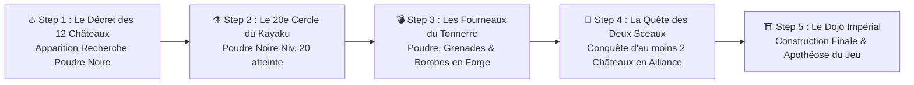
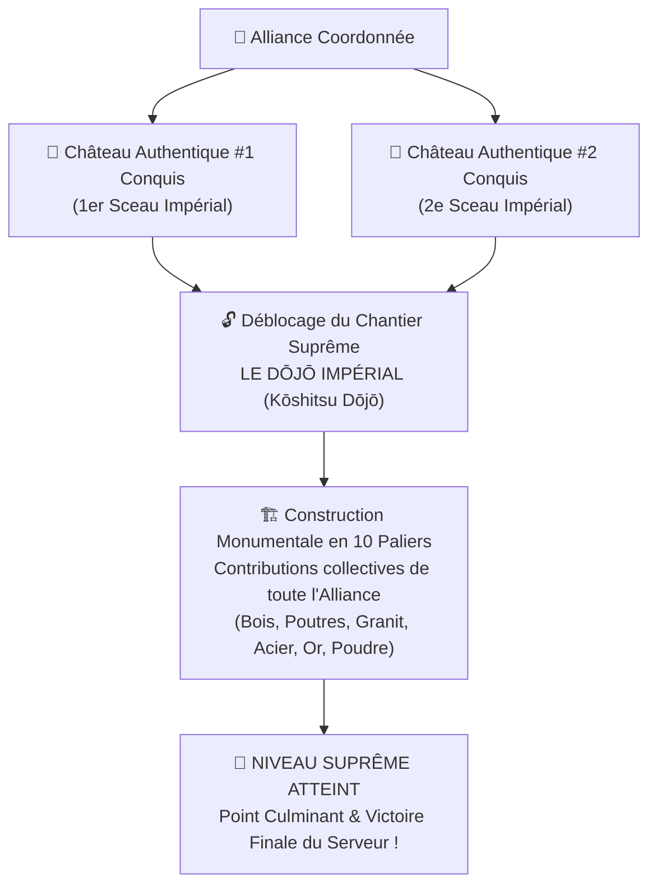

# 🏯 GDD & Scénarisation : La Guerre des Douze Châteaux (*Genson Jūni Tenshu*), la Poudre Noire & Le Dōjō Impérial

> [!IMPORTANT]
> **Position dans la Campagne d'OpenShogun :** Avant-dernière Grande Bataille (Guerre des 12 Châteaux) menant directement au **Point Culminant de Fin de Partie (Le Dōjō Impérial)**.
> **Objectif Stratégique Majeur :**
> 1. Développer la recherche **« Poudre Noire (*Kayaku* - 火薬) » jusqu'au Niveau 20** dans l'Académie des Savoirs.
> 2. Produire de la **Poudre Noire**, des **Grenades (*Hōroku-hiya*)** et des **Bombes de Siège (*Teppō-dama*)** dans la **Grande Forge**.
> 3. Mener des **Sièges Coordonnés en Alliance** pour abattre et **remporter au minimum 2 Châteaux Authentiques par Alliance** (sur les 12 du monde).
> 4. Toute Alliance détenant **au moins 2 Châteaux Authentiques** débloque le droit sacré de bâtir le **Dōjō Impérial (*Kōshitsu Dōjō* - 皇室道場)**, merveille suprême et point culminant de la fin du jeu !

---

## 📜 I. Histoire & Lore : *« Les Douze Sceaux et le Dōjō de l'Éternité »*

### 1. Le Secret des Douze Fondations Impériales
Avant de s'éteindre, le Premier Shōgun fit sceller les **Douze Reliques Fondatrices de l'Empire** au cœur des **12 Châteaux Authentiques** (*現存十二天守* : *Himeji, Matsumoto, Hikone, Bitchū Matsuyama, Inuyama, Matsue, Marugame, Matsuyama, Kōchi, Hirosaki, Maruoka, Uwajima*).

Selon le *Rouleau d'Or de Kyōto*, aucun clan ne peut prétendre au titre de **Gardien Suprême de l'Archipel** sans ériger le **Dōjō Impérial (*Kōshitsu Dōjō*)** — le sanctuaire martial absolu où convergent la Voie du Sabre et la Voie de l'Esprit.
Mais la loi impériale est implacable : **il faut unir au minimum DEUX Sceaux de Châteaux Authentiques** (le *Pilier de la Terre* et le *Pilier du Ciel*) pour poser la pierre sacrée du **Dōjō Impérial**.

### 2. La Tension Géopolitique des « 12 pour 2 »
Avec seulement **12 Châteaux Authentiques** sur l'ensemble du serveur et un prérequis strict de **2 Châteaux minimum par Alliance** :
- **Au grand maximum, seules 6 Alliances dans tout l'univers** peuvent espérer réunir les 2 Châteaux requis !
- Si une Alliance conquiert **3 ou 4 Châteaux**, elle prive mathématiquement ses rivaux de l'accès au **Dōjō Impérial**, déclenchant une course contre la montre et des guerres de coalition d'une intensité dramatique.

### 3. L'Arrivée du Maître Artificier & Le Secret du *Kayaku* (火薬)
Face aux remparts cyclopéens des 12 Châteaux, les armées classiques sont impuissantes. C'est au déclenchement de l'événement qu'intervient le personnage clé dans le Studio Narratif :
- **Personnage :** **Takayama Kagetora**, *Grand Maître Artificier du Hōjutsu (L'Art du Feu Tonnerre)* — Avatar : `🧨` / `🔥`
- **Harangue d'ouverture :**
  > *« Noble Daimyō ! Le décret impérial a retenti : seule l'Alliance qui fera tomber au moins **deux des Douze Châteaux Authentiques** réunira les Sceaux nécessaires pour ériger le **Dōjō Impérial** et sceller le destin du Japon ! Mais vos katanas se briseront sur les pierres de Himeji et de Matsumoto. Ouvrez votre **Académie des Savoirs**, poussez la maîtrise de la **Poudre Noire (Kayaku)** jusqu'au **Niveau 20**, et transformez votre **Grande Forge** en arsenal pyrotechnique ! Fondez les **Grenades Hōroku** et les **Bombes de Siège**, ralliez vos frères d'armes, et arrachez vos deux forteresses avant les clans rivaux ! »*

---

## 🗺️ II. Découpage Narratif en 5 Steps (Studio Narrative Designer 2.0)

| Step | Titre du Scénario | Déclencheur (*Trigger*) | Effet Gameplay & Récompense |
| :--- | :--- | :--- | :--- |
| **Acte I** | **Le Décret des Douze Châteaux** | Déclenchement de la Guerre des 12 Châteaux | Éveil des 12 Châteaux sur la carte + **Apparition de la recherche « Poudre Noire (*Kayaku*) »** dans l'Académie des Savoirs. |
| **Acte II** | **Le 20e Cercle de l'Alchimie Noire** | Recherche `black_powder` développée au **Niveau 20** | Débloque l'atelier **« Arsenal Pyrotechnique »** dans la **Grande Forge** (Poudre Noire, Grenades *Hōroku*, Bombes *Teppō-dama*). |
| **Acte III** | **Les Fourneaux du Tonnerre** | Production des premières Grenades & Bombes dans la Grande Forge | Débloque l'ordre d'opération **« Siège Coordonné d'Alliance »** contre les 12 Châteaux Authentiques. |
| **Acte IV** | **Les Deux Piliers de l'Alliance** | L'Alliance du joueur conquiert **au minimum 2 Châteaux Authentiques** (`castles_owned >= 2`) | Attribution des **2 Sceaux Fondateurs** à l'Alliance + **Déblocage du chantier suprême du « Dōjō Impérial (*Kōshitsu Dōjō*) »**. |
| **Acte V** | **L'Apothéose du Dōjō Impérial** | Achèvement du **Dōjō Impérial** par l'Alliance | **Point culminant de la fin du jeu** : Couronnement de l'Alliance en tant qu'Hégémonie Shōgunale, bannière impériale mondiale et Panthéon des Vainqueurs. |

---

## 🔬 III. Académie des Savoirs : La Recherche « Poudre Noire (*Kayaku* - 火薬) »

1. **Apparition Dynamique à l'ouverture de la Guerre des 12 Châteaux :**
   - La technologie **`black_powder` (« Alchimie de la Poudre Noire - Kayaku »)** apparaît dans l'**Académie des Savoirs (`?page=research`)** dès le déclenchement du conflit.
2. **Progression obligatoire jusqu'au Niveau 20 :**
   - **Niveaux 1 à 19** : Chaque niveau affine la pureté du salpêtre (`nitrate`), du soufre (`sulfur`) et du charbon (`charcoal`), augmentant les dégâts futurs de siège (`+2% / niv.`).
   - **Niveau 20 (Seuil Critique Requis)** :
     - 🔓 Déverrouille la fabrication de la **Poudre Noire**, des **Grenades *Hōroku*** et des **Bombes de Siège *Teppō-dama*** dans la **Grande Forge**.

---

## ⚒️ IV. La Grande Forge : Arsenal Pyrotechnique (Niv. 20 Poudre Noire requis)

| Engin Pyrotechnique | Code | Recette dans la Grande Forge | Fonction Tactique |
| :--- | :--- | :--- | :--- |
| **🛢️ Baril de Poudre Noire (*Kayaku*)** | `black_powder_unit` | `150 Nitrate` + `50 Soufre` + `100 Charbon de bois` | Charge explosive de base requise pour toutes les armes de siège pyrotechniques. |
| **💣 Grenade en Céramique (*Hōroku-hiya*)** | `horoku_grenade` | `1 Baril de Poudre Noire` + `300 Fer/Métal` + `150 Argile` + `50 Soufre` | **Saturation de Garnison :** Élimine les défenseurs d'élite derrière les meurtrières et applique l'effet *« Fumée Noire »* qui expose les remparts. |
| **💥 Bombe de Brèche (*Teppō-dama*)** | `siege_bomb` | `5 Barils de Poudre Noire` + `1 500 Fer/Métal` + `300 Satetsu (Sable de Fer)` + `200 Or` | **Destruction de Remparts :** Seule arme capable de détruire les millions de PV structurels des 12 Châteaux Authentiques. |

---

## ⚔️ V. Siège Coordonné des 12 Châteaux & Règle des « 2 Châteaux Minimum »

### 1. Pourquoi un joueur seul ne peut pas abattre un Château Authentique
- **Résistance Phénoménale (`2 500 000 PV de Structure` + `1 000 000 PV de Rempart` + `500 000 Garnison`)** et **95% de réduction des dégâts non-explosifs**.
- **Régénération des Brèches** si le château ne subit pas d'attaques coordonnées de plusieurs membres d'une même Alliance dans une **Fenêtre de Siège Synchronisée**.
- **Combo d'Alliance Grenades + Bombes** :
  - *Vague 1 (Alliés Grenadiers)* : les **Grenades *Hōroku*** neutralisent la garnison et ouvrent une fenêtre de vulnérabilité.
  - *Vague 2 (Alliés Bombardiers)* : les **Bombes *Teppō-dama*** frappent les fondations avec un multiplicateur de résonance d'alliance (`+25%` de dégâts par membre d'alliance participant au siège).

### 2. La Course aux 2 Châteaux par Alliance
- Lorsqu'un Château Authentique tombe à `0 PV` face aux assauts coordonnés d'une Alliance :
  - L'Alliance qui a infligé la majorité des dégâts de siège au cours de l'assaut final **remporte le Château Authentique** (`controlling_alliance_id`) et son **Sceau Impérial**.
  - **Tableau de Chasse des Alliances (Progression vers le Dōjō Impérial)** :
    - `0 / 2 Châteaux` : *Alliance en campagne*
    - `1 / 2 Châteaux` : *1er Pilier acquis — Encore 1 Château Authentique requis pour débloquer le Dōjō Impérial !*
    - `2 / 2 Châteaux (ou plus)` : **✅ Condition atteinte ! Le chantier du Dōjō Impérial est déverrouillé pour l'Alliance !**

---

## ⛩️ VI. Le Point Culminant de la Fin du Jeu : Le Dōjō Impérial (*Kōshitsu Dōjō* - 皇室道場)

### 1. Condition d'Érection & Vulnérabilité Stratégique
- **Prérequis strict d'activation :** L'Alliance doit détenir **au minimum 2 Châteaux Authentiques** parmi les 12 du monde.
- **Tension permanente (Défense des 2 Châteaux) :**
  - Si une Alliance rivale lance un siège pyrotechnique et ramène l'Alliance constructrice **en dessous de 2 Châteaux** (`< 2`), **le chantier du Dōjō Impérial est gelé (suspendu)** tant qu'un deuxième château n'est pas reconquis !
  - Chaque château supplémentaire au-delà de 2 (ex. `3`, `4` ou `5` châteaux détenus par l'Alliance) accélère la vitesse de construction du **Dōjō Impérial** de **`+15% par château supplémentaire`** !

### 2. Construction Collective & Phases du Dōjō Impérial
Le **Dōjō Impérial** apparaît à la fois dans l'espace **Alliance (`?page=alliance`)**, dans les **Bâtiments Suprêmes (`?page=building`)** et sur la **Carte du Monde (`?page=world_map`)** :
1. **Fondations de Granit & Poutres Sacrées (Niveaux 1 à 3)** : Mobilise les stocks de *Bois, Poutres de Charpente, Granit et Argile* de tous les membres de l'Alliance.
2. **Sanctuaire des Dix Mille Sabres (Niveaux 4 à 7)** : Mobilise l'*Acier/Métal, le Satetsu, le Riz, le Saké Impérial et l'Or (Kobans)*.
3. **Dôme Céleste du Shōgunat (Niveaux 8 à 10 — Apothéose)** : Requiert le maintien des **2 Châteaux Authentiques minimum**, des offrandes d'*Honneur* et une garde pyrotechnique (*Grenades & Bombes*) pour repousser les ultimes coalisés.

### 3. Effet à l'Achèvement (Fin du Jeu)
La première Alliance qui achève le **Niveau 10 du Dōjō Impérial** tout en maintenant ses **2 Châteaux Authentiques minimum** :
- Déclenche l'**Événement Mondial de Fin d'Ère : « L'Avènement du Dōjō Impérial »**.
- Inscrit tous les membres de l'Alliance au **Panthéon Impérial d'OpenShogun** avec le titre suprême de **Gardiens du Dōjō Impérial (Seii Taishōgun)**.
- Octroie l'aura dorée permanente et les reliques de victoire.
