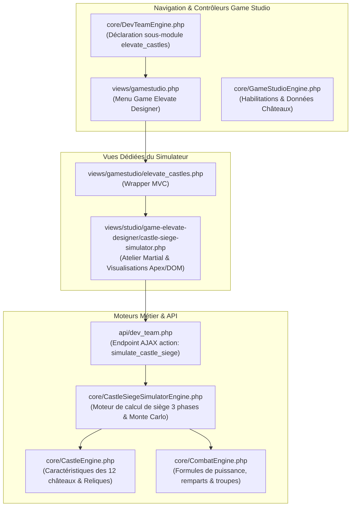
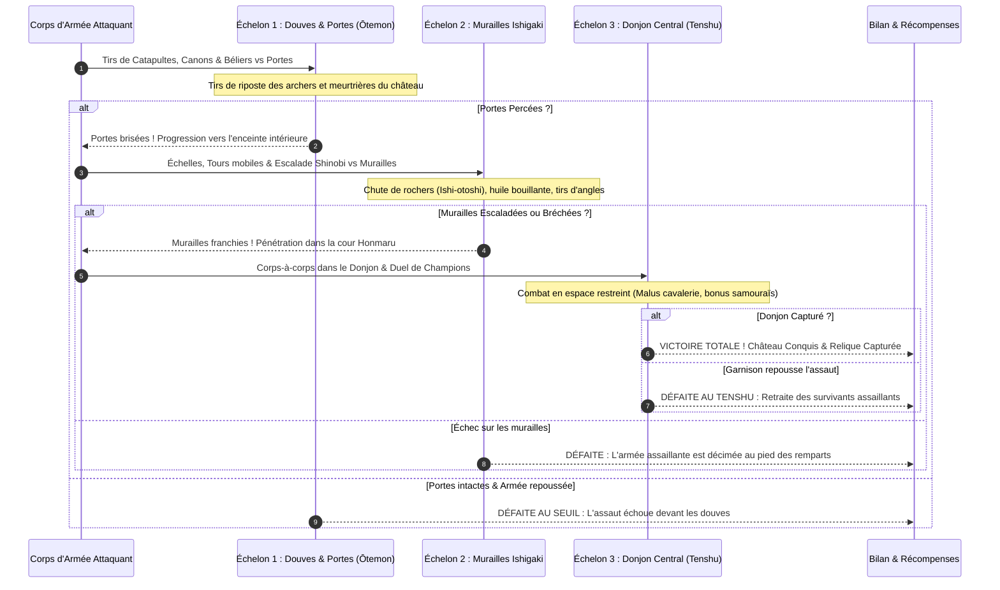
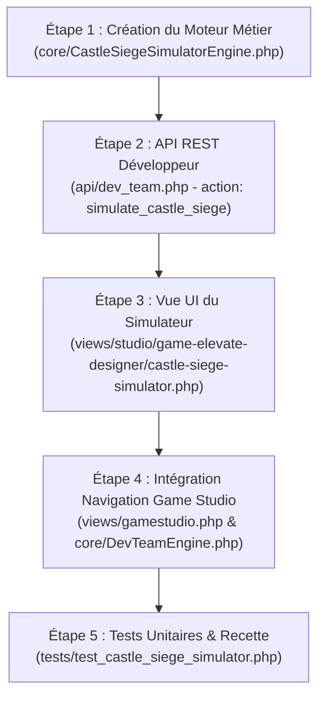

# Plan : Simulateur Tactique de Siège & Attaque sur les 12 Châteaux Authentiques
> **Métier :** Game Elevate Designer  
> **Module Game Studio :** `elevate_castles` (`views/studio/game-elevate-designer/castle-siege-simulator.php`)  
> **Route :** `?page=gamestudio&tab=elevate_castles`

---

## 1. Vision & Objectifs de Conception (Game Design)

Les **12 Châteaux Authentiques du Japon** (*現存十二天守 - Genzon Jūni Tenshu*) constituent les trésors nationaux et les enjeux stratégiques suprêmes de la carte féodale d'OpenShogun. Contrairement à un simple fief ou village de joueur, un assaut sur l'un de ces châteaux légendaires obéit à des contraintes historiques, topographiques et martiales uniques :

Le simulateur offrira aux Game Elevate Designers et au Shogunat un atelier d'équilibrage martial sans équivalent :
1. **Intégration des spécificités topographiques authentiques** : *Yamajiro* (montagne imprenable interdisant la cavalerie lourde), *Hirayamajiro* (colline et murailles en éventail *Ogi-no-kōbai*), *Hirajiro* (plaine et douves d'eau concentriques), et *Mizujiro* (forteresse navale pentagonale).
2. **Siège séquencé en 3 échelons** :
   - **Échelon 1 - Douves & Barbacanes (*Ōtemon*)** : Artillerie, archers, sapeurs et béliers.
   - **Échelon 2 - Murailles de pierre (*Ishigaki*)** : Ninjas d'escalade, mantelets, lancers de pierres (*Ishi-otoshi*) et tirs de meurtrières.
   - **Échelon 3 - Donjon central (*Tenshu*)** : Combat rapproché au sabre dans les couloirs étroits et duel d'honneur des champions/héros.
3. **Simulation unitaire & Monte-Carlo (100 passes)** : Permet de tester instantanément la robustesse d'un château face à différentes compositions d'assaut (spam d'infanterie, corps de siège à poudre noire, horde de cavalerie).
4. **Préréglages historiques 1-clic** basés sur les grandes batailles du Sengoku.

---

## 2. Architecture Technique & Fichiers Impliqués

### Nouveaux fichiers et modifications planifiées :
1. **`core/CastleSiegeSimulatorEngine.php`** *(Nouveau)* :
   - Moteur mathématique dédié au siège des donjons authentiques.
   - Gestion des malus/bonus de terrain topographique (*yamajiro, hirajiro, hirayamajiro, forteresse côtière*).
   - Résolution séquentielle des 3 phases de siège (Douves, Murailles, Tenshu).
   - Exécution unitaire ou itération Monte-Carlo (100 passes) pour estimer les pourcentages de victoire et variances.
2. **`views/studio/game-elevate-designer/castle-siege-simulator.php`** *(Nouveau)* :
   - Interface utilisateur complète et responsive (Tabler.io + FontAwesome 6).
   - Sélecteur visuel interactif des 12 Châteaux (illustrations, kanjis, reliques, provinces, altitude).
   - Colonne Assaillant (Clan, Doctrine martiale, Troupes, Engins de siège, Ninjas, Héros samouraï).
   - Colonne Donjon Défenseur (Niveau de fortification du Tenshu, Garnison ancestrale ou personnalisée, Pièges d'ishigaki, Douves).
   - Sélecteur Météo & Conditions de siège (Brume, Pluie battante, Neige boréale, Assaut nocturne).
   - Tableau de bord des résultats : jauges de progression par échelon, graphiques de pertes, log détaillé round par round et export Markdown du rapport de siège.
3. **`views/gamestudio/elevate_castles.php`** *(Nouveau)* :
   - Vue wrapper MVC pour Game Studio intégrant les vérifications d'accréditations.
4. **`views/gamestudio.php`** *(Mise à jour)* :
   - Ajout de `'elevate_castles'` dans `$allowedTabs`.
   - Ajout de l'entrée « Siège des 12 Châteaux » dans le menu déroulant *Game Elevate Designer*.
5. **`core/DevTeamEngine.php`** *(Mise à jour)* :
   - Enregistrement de `'elevate_castles'` dans `STUDIO_TABS` et `STUDIO_METIERS['game-elevate-designer']`.
6. **`api/dev_team.php`** *(Mise à jour)* :
   - Action AJAX `'simulate_castle_siege'` pour calculer les simulations côté serveur de manière sécurisée et rapide.

---

## 3. Matrice des 12 Châteaux & Spécificités de Siège

Chaque donjon authentique intègre des modificateurs tactiques reproduisant son architecture réelle :

| # | Donjon Authentique | Kanji | Type Topographique | Malus / Règle Spéciale de Siège | Relique Débloquée |
|---|-------------------|-------|--------------------|----------------------------------|-------------------|
| 1 | **Himeji** (姫路城) | 姫路 | *Hirayamajiro* (Colline) | Labyrinthe en spirale : -30% aux attaques directes, les engins doivent forcer 3 portes successives. | **Plume du Héron Blanc** : +15% Défense des Remparts |
| 2 | **Matsumoto** (松本城) | 松本 | *Hirajiro* (Plaine & Douves) | Triple ceinture de douves d'eau : Malus de -25% de vitesse, riposte d'arquebuses accrue de +20%. | **Regard du Corbeau** : +20% Attaque des Archers |
| 3 | **Inuyama** (犬山城) | 犬山 | *Hirayamajiro* (Falaise fluviale) | Falaise sur la rivière Kiso : Aucune attaque de flanc possible, seuls les assauts frontaux ou escalades sont admis. | **Cloche de Guet de Kiso** : +15% Vitesse de Déplacement |
| 4 | **Hikone** (彦根城) | 彦根 | *Hirayamajiro* (Bord de lac) | Pont basculant Tenbin-yagura : Les béliers subissent une rupture d'élan (-40% efficacité bélier). | **Étendard Diables Rouges** : +10% Attaque Cavalerie |
| 5 | **Matsue** (松江城) | 松江 | *Hirayamajiro* (Donjon Noir) | Tourelles d'angle renforcées : Tirs croisés permanents infligeant des dégâts structurels aux assaillants. | **Bouclier du Lac Shinji** : +15% Résistance Troupes |
| 6 | **Bitchū Matsuyama** (備中松山城) | 備中 | *Yamajiro* (Montagne 430m) | **Pente escarpée extrême** : Cavalerie lourde interdite, vitesse divisée par 2, fatigue accrue de l'infanterie. | **Sceau Sanctuaire Céleste** : +15% Résistance Clans |
| 7 | **Maruoka** (丸岡城) | 丸岡 | *Hirayamajiro* (Colline) | Tuiles de pierre volcanique : Immunité totale aux flèches incendiaires et incendies de siège. | **Brume Éternelle d'Echizen** : +10% Esquive Garnison |
| 8 | **Kōchi** (高知城) | 高知 | *Hirayamajiro* (Mont Otakasa) | Meurtrières Otesuji & pointes de fer anti-escalade : Malus de -50% d'efficacité pour l'escalade shinobi. | **Pacte des Yamauchi** : +10% Production Fief |
| 9 | **Uwajima** (宇和島城) | 宇和島 | *Mizujiro* (Forteresse Côtière) | **Plan pentagonal trompeur de Takatora** : Illusion d'angle exposant automatiquement l'attaquant à des tirs de revers. | **Géométrie de Takatora** : +15% Vitesse Navires |
| 10 | **Marugame** (丸亀城) | 丸亀 | *Hirayamajiro* (Colline) | **Murailles Ogi-no-kōbai (60m)** : Les murailles les plus hautes du Japon, escalade quasi-impossible sans pertes massives. | **Socle Cyclopéen de Sanuki** : +20% PV Remparts |
| 11 | **Matsuyama** (松山城) | 松山 | *Hirayamajiro* (Complexe Renritsu) | Donjons reliés par 21 coursives closes : Si une porte cède, l'attaquant est encerclé dans une cour fermée. | **Labyrinthe d'Iyo** : -20% Pertes lors des Sièges |
| 12 | **Hirosaki** (弘前城) | 弘前 | *Hirajiro* (Boréal) | Froid sibérien & triples douves gelées : Risque de rupture de glace, poudre noire moins performante sous la neige. | **Sentinelle de Tsugaru** : +15% Résistance Hivernale |

---

## 4. Déroulement du Moteur de Siège (3 Échelons Martiaux)

### Facteurs Tactiques & Météo :
- **Brume d'automne** : Réduit la précision des tirs à distance de -20%, mais augmente l'infiltration shinobi de +25%.
- **Pluie battante** : Neutralise les armes à poudre noire (*Tanegashima*) de -40% et éteint les flèches enflammées.
- **Tempête de neige** : Réduit la mobilité globale de -30% et augmente l'attrition des assaillants.
- **Assaut nocturne** : Bonus d'effet de surprise (+15% premier round), mais risque de tirs amis ou de désorganisation.

---

## 5. Préréglages Historiques 1-Clic (Scénarios Emblématiques)

1. **« Le Siège Inexpugnable d'Himeji »** : Assaut massif de 5 000 guerriers Oda contre les remparts immaculés du Héron Blanc.
2. **« L'Expédition Céleste de Bitchū Matsuyama »** : Ascension périlleuse de montagne par des troupes légères d'infanterie sous une mer de brume.
3. **« Le Choc contre les Diables Rouges de Hikone »** : Affrontement frontal contre la cavalerie d'élite Ii et le pont basculant Tenbin.
4. **« L'Infiltration Furtive de Matsumoto »** : Raid nocturne de ninjas shinobi franchissant les douves d'eau du Corbeau Noir.
5. **« Le Débarquement Pentagonale d'Uwajima »** : Opération amphibie navale piégée par les lignes brisées de Tōdō Takatora.

---

## 6. Plan d'Implémentation Étape par Étape

### Détail des Étapes :
- **Étape 1** : Concevoir `core/CastleSiegeSimulatorEngine.php` avec les formules des 3 phases de siège, les statistiques des 12 châteaux, les calculs de points de structure des remparts et l'algorithme Monte-Carlo.
- **Étape 2** : Ajouter l'action `'simulate_castle_siege'` dans `api/dev_team.php` avec vérification stricte des permissions (`formulas.tune` ou `debug.sandbox`).
- **Étape 3** : Rédiger l'interface `views/studio/game-elevate-designer/castle-siege-simulator.php` avec sélecteur de château illustré, configuration interactive en split-screen, graphiques de progression et export Markdown.
- **Étape 4** : Créer `views/gamestudio/elevate_castles.php` et raccorder le nouveau module dans la barre de navigation de `views/gamestudio.php` et `core/DevTeamEngine.php`.
- **Étape 5** : Écrire un banc d'essai complet `tests/test_castle_siege_simulator.php` vérifiant les calculs de siège, les 12 châteaux, les malus de terrain et le bon fonctionnement de l'API.

---

## 7. Vérification & Critères de Succès

1. **Précision historique et mécanique** : Les 12 châteaux doivent refléter fidèlement leurs contraintes réelles (*yamajiro* sans cavalerie lourde, bonus reliques respectés).
2. **Fluidité UI / UX** : Changement dynamique de château avec mise à jour instantanée des visuels, kanjis, lore et préréglages.
3. **Simulation instantanée** : Temps d'exécution inférieur à 50ms pour une simulation unitaire et inférieur à 300ms pour 100 itérations Monte-Carlo.
4. **Exportation documentaire** : Génération d'un rapport de siège formaté en Markdown pour intégration directe dans la documentation de Game Design.
5. **Zéro régression** : La suite complète des tests de non-régression (`tests/test_gamestudio.php`) doit continuer de passer à 100%.
